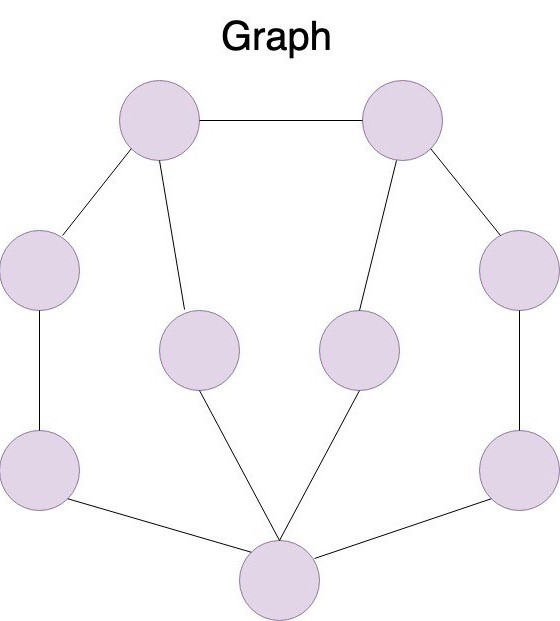
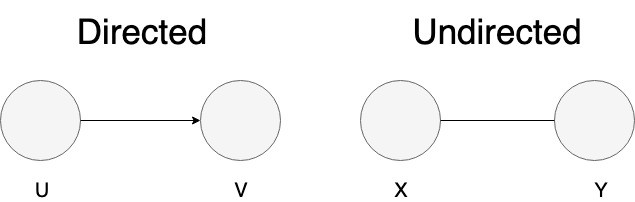
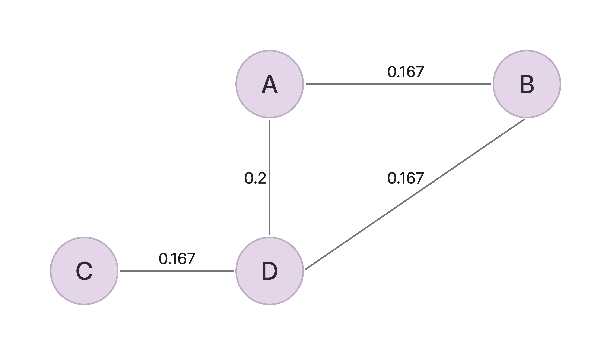

Лабораторная работа №4. Разработка системы автоматической суммаризации текстов
==============================================================================

.. toctree::
    :maxdepth: 1
    :titlesonly:

    Full API <lab_4_summarization_textrank.api.rst>

Дано
----

1. Текст на русском языке из `датасета статей сайта
   Газета.ру <https://www.kaggle.com/datasets/phoenix120/gazeta-summaries>`__
   о жизни первого космонавта `Юрия Гагарина <https://ru.wikipedia.org/wiki/Гагарин,_Юрий_Алексеевич>`__
   в папке
   `assets <https://github.com/fipl-hse/2026-2-level-labs/blob/main/lab_4_summarization_textrank/assets/article_701.txt>`__.

2. Список стоп слов (предлоги, союзы, местоимения и другие
   неполнозначные слова русского языка).
   `Ссылка <https://github.com/fipl-hse/2026-2-level-labs/blob/main/lab_4_summarization_textrank/assets/stop_words.txt>`__.

   - Данный список взят из библиотеки для работы с естественным языком
     `NLTK <https://www.nltk.org/index.html>`__.

Необходимо реализовать алгоритм, способный для произвольного текста
создавать его краткое содержание (*суммаризовать*).

Подходы к выделению краткого содержания текста
----------------------------------------------

У большинства задач есть несколько решений. Это применимо и к выделению
краткого содержания.

В зависимости от желаемой структуры краткого содержания, выделяют два
подхода:

1. *Извлекающий* (*extraction-based*) — из исходного текста
   выбираются наиболее важные фразы, предложения или абзацы, совокупность
   которых образует краткое содержание. При этом данные фрагменты не
   обрабатывают, а извлекают в том порядке и виде, в каком они приведены в
   исходном тексте.

   * **Достоинства**: независимость от предметной области, сравнительная
     простота разработки.
   * **Недостатки**: извлекающий при низкой связности суммаризатор может
     не найти значимых связей и начнет просто пересказывать исходный текст.

2. *Генерирующий* (*abstractive-based*) — генерирующие методы основаны на
   лингвистических правилах обработки естественного языка или методах
   искусственного интеллекта. Они содержательно обобщают исходный документ,
   создавая текст, явно в нём не представленный.

   * **Достоинства**: лучшее качество результата.
   * **Недостатки**: сложность практической реализации, необходимость сбора
     большого количества лингвистических знаний.

В данной работе мы будем реализовывать алгоритм, основанный на
извлекающем подходе.

Также, чтобы избежать путаницы, определим, что мы будем считать кратким
содержанием:

* *Краткое содержание* или *summary* для текста — несколько наиболее
  важных для текста предложений.

Для оценки значимости предложений мы будем использовать графовый алгоритм
**`TextRank <https://arxiv.org/pdf/1602.03606.pdf>`__**.

Терминология
------------

В данной работе Вам предлагается поработать с такой структурой организации данных,
как *граф*. Давайте коротко рассмотрим его характеристики.

Граф — сложная нелинейная структура данных, отображающая связи между разными объектами.

   `Источник картинки <https://medium.com/swlh/data-structures-graphs-50a8a032db03>`__

На картинке выше изображен граф. Круги называются **вершинами** (vertex), соединяющие их
линии — **ребрами** (edge). Как видите, может быть так, что не все вершины соединены между
собой. Если у двух вершин есть общее соединяющее их ребро, то такие вершины называются
**инцидентными**. Ребро, соединяющее вершину с самой собой, называется *петлей*. На данном
графе нет петель.

Графы бывают **ориентированные** (directed) и **неориентированные** (undirected). В
ориентированных графах ребра различаются по их направлению: есть вершина, из которой ребро
исходит, и вершина, к которой оно направлено. В неориентированных графах такого различия нет.

   `Источник картинки <https://medium.com/swlh/data-structures-graphs-50a8a032db03>`__

Графы также делятся на **взвешенные** и **невзвешенные**. Во взвешенных графах ребра могут
иметь разный вес. Так, например, на картинке ниже изображен взвешенный граф, в котором
вершинами являются предложения:

* ``A`` — "Кот спит на диване."
* ``B`` — "Кот любит играть с клубком."
* ``C`` — "Собака громко лает во дворе."
* ``D`` — "Кот и собака гуляют."

В данном графе ребра показывают связь одного предложения с другим по мере Жаккара, с
которой мы познакомимся с Вами в дальнейшем.

В настоящей лабораторной графы будут использованы как способ представить текст. В таких
графах вершинами являются предложения, а ребрами — связи (значения смежности) между ними.

Что надо сделать
----------------

Шаг 0. Начать работу над лабораторной (вместе с преподавателем на практике)
~~~~~~~~~~~~~~~~~~~~~~~~~~~~~~~~~~~~~~~~~~~~~~~~~~~~~~~~~~~~~~~~~~~~~~~~~~~

1. Измените оценку в файле ``settings.json``.
2. Измените файлы ``main.py`` и ``start.py``.
3. Закоммитьте изменения.
4. Создайте Pull request.

Реализуйте классы и функции в ``main.py`` и импортируйте их в
``start.py`` для проверки работы кода.
В модуле ``start.py`` весь код должен быть оформлен в функции ``main()``,
которая вызывается в конце файла.
Часть кода с чтением данного текста и стоп-слов и сохранением их в переменные
``text`` и ``stop_words`` уже написана.
Строчку ``assert result`` нельзя изменять и перемещать в другие места кода,
она должна остаться в конце функции ``main()``.

.. important:: В рамках данной лабораторной работы
               нельзя использовать сторонние модули и модуль collections.

.. important::  Если на вход в функцию или метод подаются некорректные аргументы,
               поднимается исключение
               :py:exc:`lab_4_summarization_textrank.main.IncorrectArgumentError`
               с соответствующим сообщением: ``"Incorrect input value"``.
               Некорректным аргумент считается, если его тип отличается от ожидаемого типа.
               О том, считаются ли пустые последовательности и словари некорректными
               аргументами, будет упомянуто в релевантных шагах.

               При ошибках в работе графа смежности (например, при добавлении петли или
               обращении к вершине, отсутствующей в графе) поднимается исключение
               :py:exc:`lab_4_summarization_textrank.main.TextGraphError`
               с сообщением, соответствующим ошибке. О необходимости использования этого
               исключения будет упомянуто в релевантных шагах.

Шаг 1. Творческое задание
~~~~~~~~~~~~~~~~~~~~~~~~~

.. important:: Выполнение Шага 1 соответствует 4 баллам.

Задание анонсируется преподавателем на практике.
Подробная информация о задании и сроки приёмки публикуются в канале курса.
Выполнение задания также является обязательным для получения оценки 6 и выше.

Шаг 2. Создание абстракции для предложения
~~~~~~~~~~~~~~~~~~~~~~~~~~~~~~~~~~~~~~~~~~

Мы научились предобрабатывать и кодировать отдельные слова, однако в задаче **извлекающей**
суммаризации базовой единицей текста выступает целое предложение.
Так как в данной работе мы будем оперировать предложениями, причём в
разных их проявлениях (сырой текст, предобработанный, закодированный),
имеет смысл создать *абстракцию*, которая будет представлять предложение
из реального мира в коде.

За это отвечает класс :py:class:`lab_4_summarization_textrank.main.Sentence`.

Шаг 2.1. Инициализация класса ``Sentence``
^^^^^^^^^^^^^^^^^^^^^^^^^^^^^^^^^^^^^^^^^^

Инициализатор :py:meth:`lab_4_summarization_textrank.main.Sentence.__init__` принимает
параметры ``text`` (текст предложения) и ``position`` (позиция предложения в тексте;
нумерация позиций начинается с нуля).

Внутри инициализатора необходимо сохранить пришедшие на вход аргументы в одноимённые
защищённые атрибуты класса: ``_text`` и ``_position``, а также создать следующие
защищённые атрибуты класса, инициализированные пустыми кортежами:

* ``_preprocessed`` — предобработанная версия предложения;
* ``_encoded`` — закодированная версия предложения.

Пример создания экземпляра класса:

.. code:: python

   sentence = Sentence("В лесу родилась ёлочка.", 0)

Шаг 2.2. Реализация методов доступа и изменения атрибутов
^^^^^^^^^^^^^^^^^^^^^^^^^^^^^^^^^^^^^^^^^^^^^^^^^^^^^^^^^

В объектно-ориентированном программировании прямой доступ к внутренним полям объекта извне
обычно ограничивают с помощью защищённых атрибутов (начинающихся с ``_``), чтобы защитить
состояние объекта от некорректных изменений. Взаимодействие с такими атрибутами строится
через единый публичный интерфейс — **геттеры** (методы чтения значения) и **сеттеры**
(методы записи значения с предварительной проверкой корректности данных).

Реализуйте следующие геттеры и сеттеры для класса
:py:class:`lab_4_summarization_textrank.main.Sentence`:

* геттеры:
  :py:meth:`lab_4_summarization_textrank.main.Sentence.get_text`,
  :py:meth:`lab_4_summarization_textrank.main.Sentence.get_position`,
  :py:meth:`lab_4_summarization_textrank.main.Sentence.get_preprocessed`,
  :py:meth:`lab_4_summarization_textrank.main.Sentence.get_encoded`;
* сеттеры:
  :py:meth:`lab_4_summarization_textrank.main.Sentence.set_preprocessed`,
  :py:meth:`lab_4_summarization_textrank.main.Sentence.set_encoded`.

Методы ``set_preprocessed`` и ``set_encoded`` принимают новое значение,
проверяют его тип и сохраняют в соответствующий защищённый атрибут экземпляра.

.. important:: При вызове сеттеров должна происходить проверка типа входных данных:

   * для :py:meth:`lab_4_summarization_textrank.main.Sentence.set_preprocessed` проверяется,
     что передана последовательность, все элементы которой являются строками;
   * для :py:meth:`lab_4_summarization_textrank.main.Sentence.set_encoded` проверяется,
     что передана последовательность, все элементы которой являются целыми числами.

   Если условие не выполняется, поднимается
   :py:exc:`lab_4_summarization_textrank.main.IncorrectArgumentError`.

Обратите внимание, что :py:meth:`lab_4_summarization_textrank.main.Sentence.set_encoded` и
:py:meth:`lab_4_summarization_textrank.main.Sentence.set_preprocessed` могут принимать пустые
последовательности.

Шаг 2.3. Описание предложения
^^^^^^^^^^^^^^^^^^^^^^^^^^^^^

В данной лабораторной работе Вы будете много работать с пользовательскими классами.
Чтобы узнать, что скрывается за интерфейсом экземпляра
:py:class:`lab_4_summarization_textrank.main.Sentence`, в общем случае понадобится
вызывать один из геттеров класса и затем функцию ``print()`` от полученного результата.

Чтобы упростить работу с классами, реализуйте служебный метод
:py:meth:`lab_4_summarization_textrank.main.Sentence.__str__`,
который возвращает строковое представление предложения в формате
``Sentence(text='Привет.', position=0)``.
Используйте значения атрибутов ``_text`` и ``_position``.

Шаг 3. Выделение и предобработка предложения
~~~~~~~~~~~~~~~~~~~~~~~~~~~~~~~~~~~~~~~~~~~~

За разделение текста на предложения и очистку каждого предложения отвечает класс
:py:class:`lab_4_summarization_textrank.main.SentencePreprocessor`.

Шаг 3.1. Инициализация класса ``SentencePreprocessor``
^^^^^^^^^^^^^^^^^^^^^^^^^^^^^^^^^^^^^^^^^^^^^^^^^^^^^^

Инициализатор :py:meth:`lab_4_summarization_textrank.main.SentencePreprocessor.__init__`
принимает параметры ``stop_words`` (последовательность стоп-слов) и ``punctuation``
(последовательность символов пунктуации, подлежащих удалению).

Внутри инициализатора необходимо сохранить пришедшие на вход аргументы в одноимённые
защищённые атрибуты класса: ``_stop_words`` и ``_punctuation``.
Допускается передача пустых последовательностей стоп-слов и знаков пунктуации.

Пример создания экземпляра класса:

.. code:: python

   stop_words = ('в', 'на', 'и')
   punctuation = ('.', ',', '!', '?')
   sentence_preprocessor = SentencePreprocessor(stop_words, punctuation)

Шаг 3.2. Разделение текста на предложения
^^^^^^^^^^^^^^^^^^^^^^^^^^^^^^^^^^^^^^^^^

Метод :py:meth:`lab_4_summarization_textrank.main.SentencePreprocessor._split_by_sentence`
разделяет текст на отдельные предложения. Метод принимает на вход неочищенный текст и
возвращает кортеж предложений.

.. important:: Каждый элемент возвращаемого кортежа — экземпляр класса
               :py:class:`lab_4_summarization_textrank.main.Sentence`.

.. important:: **Критерий разделения текста на предложения**: один из знаков препинания завершения
               предложения (``.!?``), за которым следуют пробел(ы) или символ(ы) новой
               строки и заглавная буква. Перед разделением замените в тексте символы переноса
               строки ``\n`` и повторяющиеся пробелы на одиночный пробел.

Шаг 3.3. Очистка и токенизация текста
^^^^^^^^^^^^^^^^^^^^^^^^^^^^^^^^^^^^^

Метод :py:meth:`lab_4_summarization_textrank.main.SentencePreprocessor._clean_and_tokenize`
очищает текст от знаков препинания из атрибута ``_punctuation``, приводит его к нижнему
регистру и делит на отдельные токены по пробелу. Метод возвращает кортеж выделенных токенов.

Шаг 3.4. Удаление стоп-слов
^^^^^^^^^^^^^^^^^^^^^^^^^^^

Метод :py:meth:`lab_4_summarization_textrank.main.SentencePreprocessor._remove_stop_words`
принимает последовательность токенов и возвращает кортеж токенов, не содержащий стоп-слов из
атрибута ``_stop_words``.

Принимаемая последовательность может быть пустой.

Шаг 3.5. Очистка произвольного текста
^^^^^^^^^^^^^^^^^^^^^^^^^^^^^^^^^^^^^

Метод :py:meth:`lab_4_summarization_textrank.main.SentencePreprocessor.preprocess_text`
принимает неочищенную строку и возвращает кортеж очищенных токенов без стоп-слов,
последовательно вызывая
:py:meth:`lab_4_summarization_textrank.main.SentencePreprocessor._clean_and_tokenize` и
:py:meth:`lab_4_summarization_textrank.main.SentencePreprocessor._remove_stop_words`.

Шаг 3.6. Предобработка предложений
^^^^^^^^^^^^^^^^^^^^^^^^^^^^^^^^^^

Метод :py:meth:`lab_4_summarization_textrank.main.SentencePreprocessor._preprocess_sentences`
предобрабатывает последовательность предложений с помощью
:py:meth:`lab_4_summarization_textrank.main.SentencePreprocessor.preprocess_text`.

Метод устанавливает для каждого предложения его предобработанную версию с помощью
сеттера :py:meth:`lab_4_summarization_textrank.main.Sentence.set_preprocessed`.

.. important:: Необходимо использовать методы
               :py:meth:`lab_4_summarization_textrank.main.Sentence.get_text` и
               :py:meth:`lab_4_summarization_textrank.main.Sentence.set_preprocessed` для
               взаимодействия с экземплярами класса
               :py:class:`lab_4_summarization_textrank.main.Sentence`.

Последовательность предложений на входе может быть пустая.

Шаг 3.7. Извлечение предложений из текста
^^^^^^^^^^^^^^^^^^^^^^^^^^^^^^^^^^^^^^^^^

Метод
:py:meth:`lab_4_summarization_textrank.main.SentencePreprocessor.get_sentences`
является частью публичного интерфейса класса
:py:class:`lab_4_summarization_textrank.main.SentencePreprocessor`.
Он принимает на вход текст и возвращает кортеж предобработанных предложений.

.. important:: Каждый элемент возвращаемого кортежа — экземпляр класса
               :py:class:`lab_4_summarization_textrank.main.Sentence`, у которого заполнены поля
               ``_text``, ``_position`` и ``_preprocessed``.

.. important:: Необходимо использовать методы
               :py:meth:`lab_4_summarization_textrank.main.SentencePreprocessor._split_by_sentence` и
               :py:meth:`lab_4_summarization_textrank.main.SentencePreprocessor._preprocess_sentences`.

Шаг 3.8. Описание обработчика предложений
^^^^^^^^^^^^^^^^^^^^^^^^^^^^^^^^^^^^^^^^^

Аналогично :py:meth:`lab_4_summarization_textrank.main.Sentence.__str__`,
реализуйте служебный метод
:py:meth:`lab_4_summarization_textrank.main.SentencePreprocessor.__str__`,
который возвращает строковое представление класса в формате
``SentencePreprocessor(stop_words=4, punctuation=0)``, где числа обозначают
длину последовательностей атрибутов ``_stop_words`` и ``_punctuation``.

Шаг 4. Кодирование предложения
~~~~~~~~~~~~~~~~~~~~~~~~~~~~~~

За кодирование токенов в предложениях отвечает класс
:py:class:`lab_4_summarization_textrank.main.SentenceEncoder`.

Шаг 4.1. Инициализация класса ``SentenceEncoder``
^^^^^^^^^^^^^^^^^^^^^^^^^^^^^^^^^^^^^^^^^^^^^^^^^

Инициализатор :py:meth:`lab_4_summarization_textrank.main.SentenceEncoder.__init__` не
принимает аргументов и создаёт следующие атрибуты:

* ``_word2id`` — защищённый словарь соответствий вида ``токен -> идентификатор``;
* ``_id2word`` — защищённый словарь соответствий вида ``идентификатор -> токен``;
* ``last`` — целочисленный счётчик последнего присвоенного идентификатора,
   инициализируемый числом `999`.

Пример создания экземпляра класса:

.. code:: python

   sentence_encoder = SentenceEncoder()

Шаг 4.2. Заполнение атрибутов класса
^^^^^^^^^^^^^^^^^^^^^^^^^^^^^^^^^^^^

Метод :py:meth:`lab_4_summarization_textrank.main.SentenceEncoder._learn_indices`
принимает последовательность токенов и дополняет атрибуты ``_word2id`` и ``_id2word``. Метод
ничего не возвращает. Идентификаторы присваиваются последовательно, по порядку первого
появления уникальных токенов, начиная с ``1000``.
Принимаемая последовательность токенов может быть пустой.

Рассмотрим пример. Пусть дана последовательность токенов:
``('в', 'лесу', 'родилась', 'ёлочка', 'в', 'лесу', 'она', 'росла')``.
Тогда атрибут ``_word2id`` будет выглядеть так:
``{'в': 1000, 'лесу': 1001, 'родилась': 1002, 'ёлочка': 1003, 'она': 1004, 'росла': 1005}``.

.. important:: :py:class:`lab_4_summarization_textrank.main.SentenceEncoder` обрабатывает
               предложения одно за другим, поэтому метод
               :py:meth:`lab_4_summarization_textrank.main.SentenceEncoder._learn_indices`
               должен **дополнять** атрибуты ``_word2id`` и ``_id2word``, не перезаписывая уже
               сохранённые соответствия. Атрибут ``last`` изменяется соответственно.

Шаг 4.3. Кодирование предложений
^^^^^^^^^^^^^^^^^^^^^^^^^^^^^^^^

Метод :py:meth:`lab_4_summarization_textrank.main.SentenceEncoder.encode_sentences`
принимает последовательность предложений (экземпляров класса
:py:class:`lab_4_summarization_textrank.main.Sentence`) и для каждого из них формирует
закодированную версию на основе его предобработанных токенов.
Последовательность предложений может быть пустой.

Для каждого предобработанного предложения, получаемого через
:py:meth:`lab_4_summarization_textrank.main.Sentence.get_preprocessed`
вызывается
:py:meth:`lab_4_summarization_textrank.main.SentenceEncoder._learn_indices`.

Метод изменяет каждый переданный экземпляр
:py:class:`lab_4_summarization_textrank.main.Sentence` на месте,
записывая полученный кортеж идентификаторов в его атрибут ``_encoded`` через
:py:meth:`lab_4_summarization_textrank.main.Sentence.set_encoded`.

Шаг 4.4. Описание кодировщика предложений
^^^^^^^^^^^^^^^^^^^^^^^^^^^^^^^^^^^^^^^^^

Аналогично предыдущим классам, реализуйте служебный метод
:py:meth:`lab_4_summarization_textrank.main.SentenceEncoder.__str__`,
который возвращает строковое представление класса в формате
``SentenceEncoder(vocabulary_size=5)``, где число обозначает размер
словарей с парами индексов и токенов.

Шаг 5. Демонстрация выделения и кодирования предложений
~~~~~~~~~~~~~~~~~~~~~~~~~~~~~~~~~~~~~~~~~~~~~~~~~~~~~~~

.. important:: Выполнение Шагов 1-5 соответствует 6 баллам.

В файле ``start.py`` в переменной ``text`` находится одна из статей.
Выделите из неё предложения с помощью
:py:class:`lab_4_summarization_textrank.main.SentencePreprocessor` и закодируйте их
с помощью :py:class:`lab_4_summarization_textrank.main.SentenceEncoder`.

Шаг 6. Вычисление метрики смежности
~~~~~~~~~~~~~~~~~~~~~~~~~~~~~~~~~~~

Предобработанное предложение — последовательность из токенов. Существует
`множество способов <https://aircconline.com/mlaij/V3N1/3116mlaij03.pdf>`__ узнать,
насколько две последовательности элементов похожи друг на друга.

В данной работе Вы реализуете *меру Жаккара* (*Jaccard
Similarity/Index*), которая позволяет понять, насколько два множества
элементов похожи.

Формула выглядит следующим образом:

.. math::

   J(A, B) = \frac{|A\cap B|}{|A\cup B|}

Объяснение:

* :math:`A` и :math:`B` — множества элементов;
* :math:`|A\cap B|` — количество уникальных элементов, которые являются общими для
  обоих множеств;
* :math:`|A\cup B|` — общее количество уникальных элементов в обоих множествах.

Пример:

* Множество :math:`A` — :math:`\{0, 1, 2, 5, 6\}`
* Множество :math:`B` — :math:`\{0, 2, 3, 4, 5, 7, 9\}`

.. math::

   J(A, B) = \frac{|A\cap B|}{|A\cup B|} = \frac{|\{0, 2, 5\}|}{|\{0, 1, 2, 3, 4, 5, 6, 7, 9\}|} = \frac{3}{9} = 0.3(3)

Реализуйте функцию :py:func:`lab_4_summarization_textrank.main.calculate_similarity`,
рассчитывающую значение меры Жаккара для двух последовательностей элементов.

Функция принимает на вход две последовательности элементов и возвращает значение меры Жаккара.
На данном этапе проверку типов элементов осуществлять не нужно, только проверку на то, что
принимаемый объект — последовательность.

Обратите внимание, что любой из аргументов может быть пустым. В случае,
если хотя бы одна из входных последовательностей пустая, значение меры
Жаккара равно ``0.0``.

Шаг 7. Представление текста в виде графа смежности предложений
~~~~~~~~~~~~~~~~~~~~~~~~~~~~~~~~~~~~~~~~~~~~~~~~~~~~~~~~~~~~~~

Для выделения важных предложений, нам нужно представить текст в виде графа:

* **Вершинами** графа будут предложения (экземпляры класса
  :py:class:`lab_4_summarization_textrank.main.Sentence`);
* **Рёбрами** будут значения смежности между предложениями, вычисленные с помощью
  функции :py:func:`lab_4_summarization_textrank.main.calculate_similarity` из предыдущего шага.

В этом шаге Вы будете реализовывать класс
:py:class:`lab_4_summarization_textrank.main.TextGraph`, представляющий
такой граф смежности.

Граф смежности задаётся в виде таблицы (матрицы смежности). В нашем случае
незаполненная таблица выглядит вот так.

== = = = =
\  A B C D
== = = = =
A
B
C
D
== = = = =

В ней одинаковое количество столбцов и строк. При этом каждая строка и
каждый столбец соответствуют одной какой-либо вершине графа. Например,
на пересечении строки, соответствующей вершине ``A``, и столбца,
соответствующего вершине ``B``, будет записано число, отражающее значение
смежности между этими вершинами, являющимися предложениями. Давайте
посмотрим, как она может выглядеть в заполненном виде.
Представим, что каждая буква представляет вершину графа — предложение:

* ``A`` — "Кот спит на диване."
* ``B`` — "Кот любит играть с клубком."
* ``C`` — "Собака громко лает во дворе."
* ``D`` — "Кот и собака гуляют."

Заполнение матрицы происходит в три шага:

1. **Предобработка и кодирование.** При помощи классов
   :py:class:`lab_4_summarization_textrank.main.SentencePreprocessor` и
   :py:class:`lab_4_summarization_textrank.main.SentenceEncoder` предложения очищаются от
   стоп-слов и преобразуются в кортежи числовых ID:

   .. code:: py

      encoded_sentences = {
          'A': (0, 1, 2),     # ('кот', 'спит', 'диване')
          'B': (0, 3, 4, 5),  # ('кот', 'любит', 'играть', 'клубком')
          'C': (6, 7, 8, 9),  # ('собака', 'громко', 'лает', 'дворе')
          'D': (0, 6, 10),    # ('кот', 'собака', 'гуляют')
      }

2. **Попарный расчёт меры Жаккара.** Для каждой пары предложений вызывается функция
   :py:func:`lab_4_summarization_textrank.main.calculate_similarity`:

   * ``A`` и ``B``: общий ID 0 , всего 6 уникальных ID — ``1 / 6 ≈ 0.167``;
   * ``A`` и ``C``: общих ID нет — 0.0;
   * ``A`` и ``D``: общий ID 0, всего 5 уникальных ID — ``1 / 5 = 0.2``;
   * ``B`` и ``C``: общих ID нет — 0.0;
   * ``B`` и ``D``: общий ID 0, всего 6 уникальных ID — ``1 / 6 ≈ 0.167``;
   * ``C`` и ``D``: общий ID 6, всего 6 уникальных ID — ``1 / 6 ≈ 0.167``.

3. **Заполнение матрицы смежности.** Полученные значения записываются на пересечение
   соответствующих строк и столбцов. При этом на диагонали матрицы сходство предложения с
   самим собой равно 1.0.

== ===== ===== ===== =====
\  A     B     C     D
== ===== ===== ===== =====
A  1.0   0.167 0.0   0.2
B  0.167 1.0   0.0   0.167
C  0.0   0.0   1.0   0.167
D  0.2   0.167 0.167 1.0
== ===== ===== ===== =====

Далее описаны шаги реализации графа смежности.

Шаг 7.1. Инициализация класса ``TextGraph``
^^^^^^^^^^^^^^^^^^^^^^^^^^^^^^^^^^^^^^^^^^^

Инициализатор :py:meth:`lab_4_summarization_textrank.main.TextGraph.__init__` не
принимает аргументов и создаёт защищённые атрибуты:

* ``_vertices`` — список вершин графа (экземпляров
  :py:class:`lab_4_summarization_textrank.main.Sentence`), пустой при инициализации;
* ``_matrix`` — матрицу смежности, кодирующую связи между вершинами (пустой список при
  инициализации; ожидаемый тип данных: ``list[list[float]]``).

.. important:: В матрице смежности ``_matrix``, которую Вы реализуете, должны храниться только
               строки и столбцы с вещественными числами (значениями смежности). Названия колонок и
               строк в примере выше даны исключительно для наглядности.

Пример создания экземпляра класса:

.. code:: python

   graph = TextGraph()

Шаг 7.2. Добавление вершины
^^^^^^^^^^^^^^^^^^^^^^^^^^^

Реализуйте вспомогательный метод
:py:meth:`lab_4_summarization_textrank.main.TextGraph._add_vertex`. Метод принимает
вершину (экземпляр :py:class:`lab_4_summarization_textrank.main.Sentence`).

Если такой объект ещё не сохранён в ``_vertices``, метод добавляет его в ``_vertices`` и
синхронно расширяет матрицу ``_matrix`` (добавляет новый столбец и новую строку,
заполненные нулями ``0.0``). Вычисление весов рёбер в этом методе **не выполняется** —
за расчёт смежности отвечает метод
:py:meth:`lab_4_summarization_textrank.main.TextGraph._add_edge`.
Повторное добавление уже существующей вершины не должно изменять граф. Метод ничего не
возвращает.

Шаг 7.3. Проверка вершины
^^^^^^^^^^^^^^^^^^^^^^^^^

В дальнейшем Вам понадобится убедиться в том, что вершина случайно не сравнилась с самой собой.
Так как вершины являются экземплярами класса :py:class:`lab_4_summarization_textrank.main.Sentence`,
проверку удобнее всего совершать внутренне. Дополните поведение класса реализацией служебного метода
:py:meth:`lab_4_summarization_textrank.main.Sentence.__eq__`,
который вызывается каждый раз, когда Вы проверяете эквивалентность с помощью
``==`` и ``!=``. В качестве критериев эквивалентности двух предложений
используйте значения атрибутов ``_text`` и ``_position``. То есть, внутри метода от Вас требуется
сравнить значения атрибутов ``_text`` и ``_position`` текущего предложения и предложения, переданного
как аргумент, и вернуть результат.

Определение :py:meth:`lab_4_summarization_textrank.main.Sentence.__eq__` для пользовательского
класса по умолчанию делает экземпляры класса нехэшируемыми. Это плохо, так как в дальнейшем мы
будем использовать вершины (предложения) в качестве ключей словаря, а, как мы знаем, ключи словаря
обязательно должны быть хэшируемы.

Реализуйте метод :py:meth:`lab_4_summarization_textrank.main.Sentence.__hash__`,
который решает эту проблему. Возвращаемое значение представляет собой хэш, взятый от кортежа
значений атрибутов ``_text`` и ``_position``.

Шаг 7.4. Добавление ребра
^^^^^^^^^^^^^^^^^^^^^^^^^

В данной лабораторной граф является изменяемой структурой данных: мы
можем добавлять вершины и ребра после инициализации объекта.

Ответственным за это является метод
:py:meth:`lab_4_summarization_textrank.main.TextGraph._add_edge`. Он принимает на вход
две вершины.

.. important:: Петли, то есть ребра, соединяющие вершину с самой собой, добавлять нельзя.
               Если в качестве обоих входных аргументов переданы одинаковые вершины,
               поднимается исключение :py:exc:`lab_4_summarization_textrank.main.TextGraphError`.

В случае, если какой-либо из вершин, пришедших в качестве аргумента, в графе ещё нет,
необходимо добавить её с помощью метода
:py:meth:`lab_4_summarization_textrank.main.TextGraph._add_vertex`.

Далее метод вычисляет вес ребра для закодированной формы обоих вершин
(получаемой из :py:meth:`lab_4_summarization_textrank.main.Sentence.get_encoded`)
с помощью функции :py:func:`lab_4_summarization_textrank.main.calculate_similarity`
и сохраняет полученное значение в симметричные ячейки матрицы
``_matrix`` (на пересечении строки первой вершины и столбца второй, а также строки второй
вершины и столбца первой). Метод ничего не возвращает.

Шаг 7.5. Получение значения метрики смежности
^^^^^^^^^^^^^^^^^^^^^^^^^^^^^^^^^^^^^^^^^^^^^

Для использования графа необходимо иметь возможность запросить у него
информацию о том, насколько связаны две вершины друг с другом. Для этого нужно определить метод
:py:meth:`lab_4_summarization_textrank.main.TextGraph.get_similarity_score`. Метод
принимает на вход два аргумента: вершина №1 и вершина №2.

Метод возвращает значение смежности между двумя вершинами из графа смежности.
Он не вызывает другие методы и не обновляет атрибуты класса.

Если какая-либо из запрошенных вершин отсутствует в графе, поднимается
исключение :py:exc:`lab_4_summarization_textrank.main.TextGraphError`.

Шаг 7.6. Получение информации обо всех вершинах
^^^^^^^^^^^^^^^^^^^^^^^^^^^^^^^^^^^^^^^^^^^^^^^

Также необходимо реализовать возможность узнать, какие вершины есть в
графе. Для этого следует реализовать метод
:py:meth:`lab_4_summarization_textrank.main.TextGraph.get_vertices`. Он не
принимает никаких дополнительных аргументов. Возвращаемым значением
является кортеж вершин сохраненного графа.

Шаг 7.7. Подсчет количества смежных вершин
^^^^^^^^^^^^^^^^^^^^^^^^^^^^^^^^^^^^^^^^^^

Для алгоритма выявления важных предложений важно знать,
со сколькими другими вершинами графа каждая конкретная вершина соединена ребром
(имеет ненулевую смежность). Это значение называется ``InOut score``. При суммаризации
мы считаем, что две различные вершины соединены ребром, если значение метрики смежности для них
больше ``0``.

Метод :py:meth:`lab_4_summarization_textrank.main.TextGraph.calculate_inout_score`
принимает на вход вершину и возвращает количество других вершин графа, связанных с ней
ребром положительного веса. Если на вход приходит вершина, которой нет в графе, поднимается
исключение :py:exc:`lab_4_summarization_textrank.main.TextGraphError`.

Шаг 7.8. Заполнение экземпляра графа
^^^^^^^^^^^^^^^^^^^^^^^^^^^^^^^^^^^^

Для упрощения работы с экземпляром графа реализуем метод
:py:meth:`lab_4_summarization_textrank.main.TextGraph.build`,
который заполнит его всеми вершинами и ребрами, которые можно извлечь из
последовательности предложений.

Метод принимает на вход непустую последовательность предложений.
При заполнении графа обязательно используйте метод
:py:meth:`lab_4_summarization_textrank.main.TextGraph._add_vertex`,
чтобы добавить каждое входное предложение в качестве вершины.

Внутри метода происходит выделение пар предложений и добавление
соответствующих ребер в граф. Необходимо обращаться к методу
:py:meth:`lab_4_summarization_textrank.main.TextGraph._add_edge`.

Метод :py:meth:`lab_4_summarization_textrank.main.TextGraph.build` ничего не возвращает.

Обратите внимание, что текст может содержать одинаковые предложения.
Метод не должен передавать в
:py:meth:`lab_4_summarization_textrank.main.TextGraph._add_edge` одинаковые предложения.

Шаг 7.9. Отбор лучших вершин
^^^^^^^^^^^^^^^^^^^^^^^^^^^^

Проведите отбор лучших предложений для графа.
Для этого реализуйте метод
:py:meth:`lab_4_summarization_textrank.main.TextGraph.get_top_n_sentences`,
который принимает целое положительное число ``n`` и возвращает кортеж из ``n``
предложений с наибольшей суммой значений смежности в матрице ``_matrix``.

Если на момент вызова метода в графе нет вершин, поднимается
исключение :py:exc:`lab_4_summarization_textrank.main.TextGraphError`.

Шаг 7.10. Описание графа
^^^^^^^^^^^^^^^^^^^^^^^^

Реализуйте служебные методы класса :py:class:`lab_4_summarization_textrank.main.TextGraph`:

* :py:meth:`lab_4_summarization_textrank.main.TextGraph.__len__` — возвращает целочисленное
  количество вершин в графе;
* :py:meth:`lab_4_summarization_textrank.main.TextGraph.__str__` — возвращает строковое
  представление графа в формате ``TextGraph(vertices=4)``, где число означает количество
  вершин в графе (его размер).

Благодаря этому вызов ``len(graph)`` вернёт количество предложений в графе,
а ``print(graph)`` выведет его краткое описание.

Шаг 8. Наивная суммаризация
~~~~~~~~~~~~~~~~~~~~~~~~~~~

Класс :py:class:`lab_4_summarization_textrank.main.NaiveSummarizer` реализует базовый
(наивный) графовый суммаризатор и определяет общий публичный интерфейс для графовых
алгоритмов суммаризации.

Шаг 8.1. Инициализация класса ``NaiveSummarizer``
^^^^^^^^^^^^^^^^^^^^^^^^^^^^^^^^^^^^^^^^^^^^^^^^^

Инициализатор :py:meth:`lab_4_summarization_textrank.main.NaiveSummarizer.__init__`
принимает построенный экземпляр :py:class:`lab_4_summarization_textrank.main.TextGraph`,
который необходимо сохранить в защищённый атрибут ``_graph``.

Пример создания экземпляра класса:

.. code:: python

   summarizer = NaiveSummarizer(graph)

Шаг 8.2. Отбор лучших предложений
^^^^^^^^^^^^^^^^^^^^^^^^^^^^^^^^^

Реализуйте метод :py:meth:`lab_4_summarization_textrank.main.NaiveSummarizer._get_top_n_sentences`,
отбирающий лучшие предложения путём вызова метода
:py:meth:`lab_4_summarization_textrank.main.TextGraph.get_top_n_sentences`
от сохранённого экземпляра графа.

Шаг 8.3. Составление краткого содержания
^^^^^^^^^^^^^^^^^^^^^^^^^^^^^^^^^^^^^^^^

Метод :py:meth:`lab_4_summarization_textrank.main.NaiveSummarizer.summarize`
упорядочивает переданные предложения по возрастанию их исходной позиции в тексте
(:py:meth:`lab_4_summarization_textrank.main.Sentence.get_position`), извлекает их текст с
помощью :py:meth:`lab_4_summarization_textrank.main.Sentence.get_text` и объединяет через
символ переноса строки ``\n``.

Для примера возьмем матрицу из предыдущего шага:

== ===== ===== ===== =====
\  A     B     C     D
== ===== ===== ===== =====
A  1.0   0.167 0.0   0.2
B  0.167 1.0   0.0   0.167
C  0.0   0.0   1.0   0.167
D  0.2   0.167 0.167 1.0
== ===== ===== ===== =====

Метод :py:meth:`lab_4_summarization_textrank.main.TextGraph.get_top_n_sentences`
  считает сумму значений смежности по каждой строке матрицы:

.. code:: py

   scores = {
       'A': 1.367,  # 1.0 + 0.167 + 0.0 + 0.2
       'B': 1.334,  # 0.167 + 1.0 + 0.0 + 0.167
       'C': 1.167,  # 0.0 + 0.0 + 1.0 + 0.167
       'D': 1.534,  # 0.2 + 0.167 + 0.167 + 1.0
   }

После вызова ``_get_top_n_sentences(2)`` возвращаются два предложения с наибольшей суммой:

.. code:: py

   top_sentences = ('D', 'A')

В результате ``summarize(n_sentences=2)`` сортирует выбранные предложения в исходном
порядке текста и возвращает их, соединённые символом ``\n`` (сначала ``A``, затем ``D``).

Шаг 8.4. Описание наивного суммаризатора
^^^^^^^^^^^^^^^^^^^^^^^^^^^^^^^^^^^^^^^^

Аналогично предыдущим классам, реализуйте служебный метод
:py:meth:`lab_4_summarization_textrank.main.NaiveSummarizer.__str__`,
который возвращает строковое представление класса в формате
``NaiveSummarizer(graph=TextGraph(vertices=53))``.

Шаг 9. Демонстрация работы алгоритма NaiveSummarizer
~~~~~~~~~~~~~~~~~~~~~~~~~~~~~~~~~~~~~~~~~~~~~~~~~~~~

.. important:: Выполнение Шагов 1-9 соответствует 8 баллам.

Продемонстрируйте выделение краткого содержания для текста, хранящегося
в переменной ``text``, в файле ``start.py``.
После Шага 5 текст должен быть предобработан, а предложения закодированы.

Постройте граф :py:class:`lab_4_summarization_textrank.main.TextGraph`,
затем создайте экземпляр :py:class:`lab_4_summarization_textrank.main.NaiveSummarizer`
на основе этого графа и получите краткое содержание текста из 5 предложений.
Если текст короче, получите содержание на основе длины графа.

Шаг 10. Алгоритм TextRank
~~~~~~~~~~~~~~~~~~~~~~~~~

Алгоритм **TextRank** оценивает важность каждой вершины графа следующим образом: предложение
считается тем важнее, чем с большим количеством других важных предложений оно связано.

:py:class:`lab_4_summarization_textrank.main.TextRankSummarizer` наследуется от
:py:class:`lab_4_summarization_textrank.main.NaiveSummarizer` и использует тот же
:py:class:`lab_4_summarization_textrank.main.TextGraph`. Новый граф для TextRank создавать не
нужно. Класс оптимизированного суммаризатора использует интерфейс базового суммаризатора
и дополняет его собственными методами и атрибутами.

.. code:: python

   text_rank = TextRankSummarizer(text_graph)
   text_rank.train()
   summary = text_rank.summarize(10)

Шаг 10.1. Инициализация класса ``TextRankSummarizer``
^^^^^^^^^^^^^^^^^^^^^^^^^^^^^^^^^^^^^^^^^^^^^^^^^^^^^

В инициализаторе :py:meth:`lab_4_summarization_textrank.main.TextRankSummarizer.__init__`
вызовите инициализатор родительского класса
:py:meth:`lab_4_summarization_textrank.main.NaiveSummarizer.__init__`.
Передайте ему получаемый аргумент графа
:py:class:`lab_4_summarization_textrank.main.TextGraph`.

Дополнительно задайте защищённые атрибуты параметров алгоритма:

* ``_damping_factor`` — ``0.85`` (коэффициент затухания :math:`d`);
* ``_convergence_threshold`` — ``0.0001`` (порог сходимости алгоритма);
* ``_max_iter`` — ``50`` (максимальное число итераций);
* ``_scores`` — словарь оценок значимости вершин (инициализируется пустым словарём).

Пример создания экземпляра класса:

.. code:: python

   text_rank = TextRankSummarizer(graph)

Шаг 10.2. Обновление веса вершины
^^^^^^^^^^^^^^^^^^^^^^^^^^^^^^^^^

Реализуйте метод
:py:meth:`lab_4_summarization_textrank.main.TextRankSummarizer._update_vertex_score`,
который пересчитывает оценку значимости одной вершины графа на текущей итерации алгоритма
TextRank.

Входные аргументы метода:

* ``vertex`` (:py:class:`lab_4_summarization_textrank.main.Sentence`) — вершина :math:`V_i`,
  для которой вычисляется новый вес.
* ``incidental_vertices`` (последовательность экземпляров
  :py:class:`lab_4_summarization_textrank.main.Sentence`) — список вершин :math:`InOut(V_i)`,
  имеющих положительную смежность с ``vertex``. Список вершин может быть пустым.
* ``current_scores`` (``dict[Sentence, float]``) — словарь оценок всех вершин с предыдущей итерации.
   Словарь оценок не может быть пустым. Проверять элементы словаря не требуется.

Формула расчёта веса вершины:

.. math::

   WS(V_i) = (1 - d) + d \times \sum_{V_j \in InOut(V_i)} \frac{1}{|InOut(V_j)|} WS(V_j)

Пошаговый алгоритм вычисления нового веса:

1. Инициализируйте переменную накопителя суммы для вершины.
2. Для каждой смежной вершины из ``incidental_vertices``:

   * получите количество её смежных рёбер с помощью метода
     :py:meth:`lab_4_summarization_textrank.main.TextGraph.calculate_inout_score`;
   * прибавьте к переменной накопителя суммы частное деления веса вершины с
      предыдущей итерации (значения аргумента ``current_scores`` для вершины)
      на количество смежных рёбер.

3. Вычислите итоговый вес вершины с учётом коэффициента затухания
4. Обновите ``self._scores`` новым весом.

Шаг 10.3. Итеративное обучение TextRank
^^^^^^^^^^^^^^^^^^^^^^^^^^^^^^^^^^^^^^^

Реализуйте метод :py:meth:`lab_4_summarization_textrank.main.TextRankSummarizer.train`:
назначьте всем вершинам из :py:meth:`lab_4_summarization_textrank.main.TextGraph.get_vertices`
начальный вес ``1.0`` в словаре ``_scores`` и итеративно пересчитывайте оценки с помощью
:py:meth:`lab_4_summarization_textrank.main.TextRankSummarizer._update_vertex_score`, пока
суммарное абсолютное изменение оценок за итерацию не станет меньше или равно
``_convergence_threshold`` либо пока не будет достигнуто ``_max_iter`` итераций.

Вам необходимо:

1. Получить все вершины графа и назначить каждой начальный вес ``1.0`` в словаре ``self._scores``.
2. В начале каждой итерации (не более ``_max_iter``) сохранить копию оценок предыдущего шага
   (``prev_score``), чтобы при расчётах опираться только на оценки предыдущей итерации и
   обновление весов происходило синхронно.
3. Для каждой вершины собрать список других похожих вершин (тех, у которых значение смежности с ней
   строго больше ``0``).
4. Обновить вес вершины в ``self._scores``, передав её, список похожих вершин и ``prev_score``.
5. Вычислить сумму модулей разностей между старыми и новыми весами всех вершин. Если сумма
   не превышает ``_convergence_threshold``, завершить обучение досрочно; иначе вернуться на шаг 2.

В данном методе необходимо использовать методы
:py:meth:`lab_4_summarization_textrank.main.TextGraph.get_vertices`,
:py:meth:`lab_4_summarization_textrank.main.TextGraph.get_similarity_score` и
:py:meth:`lab_4_summarization_textrank.main.TextRankSummarizer._update_vertex_score`.

Например, по матрице сходства из предыдущего шага можно выделить следующие связи:

* ``A`` — связана с ``B`` и ``D`` (:math:`|InOut(A)| = 2`);
* ``B`` — связана с ``A`` и ``D`` (:math:`|InOut(B)| = 2`);
* ``C`` — связана только с ``D`` (:math:`|InOut(C)| = 1`);
* ``D`` — связана с ``A``, ``B`` и ``C`` (:math:`|InOut(D)| = 3`).

Обучение начинается с веса ``1.0`` для каждой вершины:

* **Итерация 1**:

  * ``A`` отдаёт по ``1.0 / 2 = 0.5`` вершинам ``B`` и ``D``;
  * ``B`` отдаёт по ``1.0 / 2 = 0.5`` вершинам ``A`` и ``D``;
  * ``C`` отдаёт ``1.0 / 1 = 1.0`` вершине ``D``;
  * ``D`` отдаёт по ``1.0 / 3 ≈ 0.333`` вершинам ``A``, ``B`` и ``C``.

  Собираем входящие доли, умножаем на ``d = 0.85`` и прибавляем базовый вес ``1 - d = 0.15``:

  * ``D`` — ``0.15 + 0.85 * (0.5 + 0.5 + 1.0) = 1.85``
  * ``A`` — ``0.15 + 0.85 * (0.5 + 0.333) ≈ 0.858``
  * ``B`` — ``0.15 + 0.85 * (0.5 + 0.333) ≈ 0.858``
  * ``C`` — ``0.15 + 0.85 * 0.333 ≈ 0.433``

  Как можно видеть, вершина ``D`` резко приобретает максимальное значение, потому что
  связана со всеми остальными вершинами.

* **Итерация 2**:

  * ``D`` — ``0.15 + 0.85 * (0.858 / 2 + 0.858 / 2 + 0.433 / 1) ≈ 1.247``
  * ``A`` — ``0.15 + 0.85 * (0.858 / 2 + 1.85 / 3) ≈ 1.039``
  * ``B`` — ``0.15 + 0.85 * (0.858 / 2 + 1.85 / 3) ≈ 1.039``
  * ``C`` — ``0.15 + 0.85 * (1.85 / 3) ≈ 0.674``

  Здесь вес вершины ``D`` затухает, а остальные вершины ``A``, ``B`` и ``C``, наоборот,
  приобретают больший вес. На следующих итерациях изменения постепенно затухают, пока сумма
  модулей разностей всех весов не станет меньше порога ``0.0001`` или не будет достигнут
  максимум итераций.

Метод обновляет ``_scores`` и ничего не возвращает.

Шаг 10.4. Отбор лучших предложений для суммаризации
^^^^^^^^^^^^^^^^^^^^^^^^^^^^^^^^^^^^^^^^^^^^^^^^^^^

Напомним, что :py:class:`lab_4_summarization_textrank.main.TextRankSummarizer`
имеет тот же интерфейс, что и его класс-родитель
:py:class:`lab_4_summarization_textrank.main.NaiveSummarizer`, а значит имеет
публичный метод :py:meth:`lab_4_summarization_textrank.main.NaiveSummarizer.summarize`.

.. code:: python

   text_rank = TextRankSummarizer(text_graph)
   text_rank.train()
   summary = text_rank.summarize(10)

Теперь, когда мы описали работу нового алгоритма поиска важных предложений,
нам нужно подогнать новое решение под реализацию
:py:meth:`lab_4_summarization_textrank.main.NaiveSummarizer.summarize` — этот метод
только выводит полученный результат.

Переопределите метод
:py:meth:`lab_4_summarization_textrank.main.TextRankSummarizer._get_top_n_sentences`.
Он отбирает предложения с наибольшими весами из ``_scores``.
Результат этого отбора будет использован для построения краткого содержания в
:py:meth:`lab_4_summarization_textrank.main.NaiveSummarizer.summarize`.

Шаг 10.5. Описание суммаризатора TextRank
^^^^^^^^^^^^^^^^^^^^^^^^^^^^^^^^^^^^^^^^^

Аналогично предыдущим классам, реализуйте служебный метод
:py:meth:`lab_4_summarization_textrank.main.TextRankSummarizer.__str__`,
который возвращает строковое представление класса в формате

.. code::

   TextRankSummarizer(
      graph=TextGraph(vertices=53),
      damping_factor=0.85,
      convergence_threshold=0.0001,
      max_iter=50
   )

Так как теперь размер исходного графа находится в нескольких оболочках
описания, будет удобно реализовать метод
:py:meth:`lab_4_summarization_textrank.main.TextRankSummarizer.__len__`,
который сразу возвращает количество вершин в используемом графе, не требуя
обращения ко защищённому состоянию.

Шаг 11. Демонстрация алгоритма TextRank
~~~~~~~~~~~~~~~~~~~~~~~~~~~~~~~~~~~~~~~

.. important:: Выполнение Шагов 1-11 соответствует 10 баллам.

Продемонстрируйте выделение краткого содержания для текста, хранящегося
в переменной ``text``, в файле ``start.py``.

После Шага 9 текст должен быть предобработан, предложения закодированы, а также
построен граф :py:class:`lab_4_summarization_textrank.main.TextGraph`.

Создайте экземпляр класса :py:class:`lab_4_summarization_textrank.main.TextRankSummarizer`
на основе этого графа и получите краткое содержание текста из 5 предложений.
Если текст короче, получите содержание на основе длины графа.

.. hint:: Полиморфизм суммаризаторов
          Поскольку :py:class:`lab_4_summarization_textrank.main.TextRankSummarizer` наследуется
          от :py:class:`lab_4_summarization_textrank.main.NaiveSummarizer`, их экземпляры
          являются полиморфными по определению и предоставляют единый публичный интерфейс
          (:py:meth:`lab_4_summarization_textrank.main.NaiveSummarizer.summarize`).
          Продемонстрируйте это в ``start.py``: поместите оба суммаризатора в одну коллекцию
          (например, кортеж) и обработайте их в едином цикле, вызывая для каждого объекта
          построение краткого содержания без проверки его конкретного типа.

Узнать больше
-------------

- `Подходы к суммаризации
  текста <https://arxiv.org/pdf/1904.00688.pdf>`__
- `Метрики смежности
  последовательностей <https://aircconline.com/mlaij/V3N1/3116mlaij03.pdf>`__
- `TextRank для суммаризации <https://arxiv.org/pdf/1602.03606.pdf>`__
